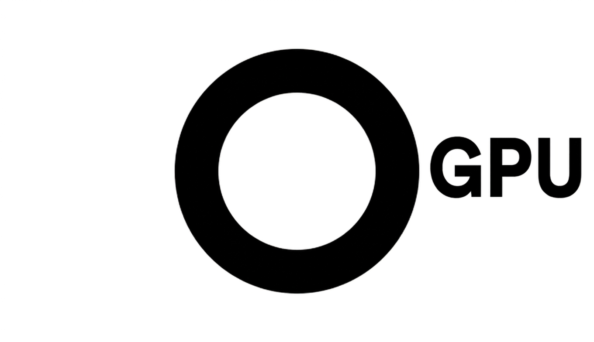

<p align="center"></p>

<p align="center"><b>Minimal WebGPU framework.</b></p>

<p align="center"><a href="https://oframe.github.io/ogpu/">Examples</a></p>

<br />

OGPU is a small WebGPU framework that continues the ethos of [OGL](https://github.com/oframe/ogl): an approachable interface with a thin abstraction layer that keeps easy access to the metal — in this case, WebGPU. It belongs to the [OFrame](https://github.com/oframe) family, carrying the same minimal-abstraction philosophy that [Nathan Gordon](https://github.com/gordonnl) set with OGL.

Written in vanilla ES modules with a Vite build, the API shares many similarities with THREE, but it is tightly coupled to WebGPU and ships far fewer features. The library does the minimum abstraction necessary, so you should still feel comfortable reaching for native WebGPU commands alongside it.

Keeping the level of abstraction low makes the framework easier to understand, extend, and reshape — and makes it a far more practical resource for learning WebGPU itself.

All vertex, fragment, and compute shaders are written — as they should be — in **WGSL**. No node graph, no TSL. You write WGSL, the framework reflects it, and that's the contract. This is a deliberate choice, not a missing feature.

## Not an npm package — a starter culture

OGPU is **not** published to npm, and that's on purpose. There's no build artifact to install and no stable public API to import against.

Treat this repo like a sourdough starter: a strong, living base you take and make your own. Fork it, extend it, or completely reshape it however you see fit. The point isn't a frozen framework — it's a clean, readable WebGPU foundation for either **learning WebGPU** or **growing your own engine** from a base that already has the hard parts solved. Today's LLMs are more than capable of carrying that reshaping for you.

To start:

```bash
git clone https://github.com/oframe/ogpu my-app
cd my-app
npm install
npm run dev        # Vite dev server, default http://localhost:5173
```

## Built for agentic development

OGPU is deliberately geared toward development with coding agents (Claude Code, Codex, Cursor, Gemini CLI). Because you grow it rather than import it, the framework's real value is in how easy it is for an LLM to navigate, reason about, and extend. The strategies baked in for that:

- **`AGENTS.md` is the shared source of truth.** It maps the whole architecture, the cross-cutting model, and the conventions that reflection depends on. `CLAUDE.md` / `GEMINI.md` / the Cursor rule are one-line bridges to it, so nothing is duplicated. Point your agent here first.
- **Per-directory `CLAUDE.md` files.** Each source directory carries its own footguns and _why_, so the right context loads next to the code an agent is editing — not buried in one giant root file.
- **Generated navigation artifacts.** `api-digest.md` is a terse index of the public surface (every exported class, its method signatures, exported functions) — the canonical _what_, so an agent never has to open a file just to learn a signature. `module-graph.json` is the static import graph (who-imports-what, with the structural hubs ranked) — so an agent traces dependencies instead of grepping. Both are regenerated by `npm run repomap` and kept honest by a pre-commit drift gate.
- **Offline WGSL validation.** Every `.wgsl` file in the repo is compiled by [naga](https://github.com/gfx-rs/wgpu/tree/trunk/naga), the wgpu reference compiler, so an agent verifies shader edits without a browser. Two ways in: a `PostToolUse` hook validates each shader the moment an agent writes it and hands the compiler error straight back — a broken shader gets fixed in the same turn rather than at runtime — and `npm run validate:shaders` batch-checks the whole tree for CI or a wide refactor. naga isn't bundled; install it with `brew install naga-cli` (or `cargo install naga-cli`). The script exits with code 2 if it's missing.

    > Note the `-cli` suffix: Homebrew's `naga` formula is an unrelated terminal Snake game, and the two conflict because both install a `naga` binary. If you grabbed the wrong one: `brew uninstall naga && brew install naga-cli`.

    > Working in Claude Code? The `naga-setup` skill (`.claude/skills/naga-setup/`) installs all of this — hook, batch script, and the `naga`/`jq` binaries — into any repo. Worth running on a fresh clone of this one too: the hook and script arrive with the clone, but `naga` is a binary on your machine and doesn't, which leaves a hook that fires and silently does nothing.

## Structure

The framework is split into **Core**, **Math**, and **Modules**.

The **Core** (`src/core/`) holds the engine primitives. A drawable is a `Mesh`: geometry + `Shader` + a plain `state` object + bind groups. You never build a render pipeline for it — the renderer derives one and caches it.

- **`Shader`** — wraps a WGSL module with a `vs`/`fs` entry pair. It appends the engine block (`engine.wgsl`), reflects the result with the in-house `reflect/` (on [`wgsl_reflect`](https://github.com/brendan-duncan/wgsl_reflect)), and serves the bind group layouts. `shader.bindGroup(0, { name: resource })` binds by WGSL name. Group(1) is the engine's: `camera.*` (projection/view matrices, `cameraPosition`, `cameraQuaternion`, `time`, `resolution`) and `object.*` (`modelMatrix`, `modelViewMatrix`, `normalMatrix`, `objectMatrix`) are written per pass and per draw into one renderer-owned `PerDrawBuffer` and bound by dynamic offset, so one mesh can draw into several passes of one submit (shadow + main) without stomping itself.
- **`Mesh`** — a `Transform` holding `geometry`, `shader`, `state` and `bindGroups`; no `gpu`, no GPU objects of its own. `state` (`transparent`, `depthWrite`, `cullMode`, `topology`, `blending`, …) is frozen — swap the object to change it. The renderer's `PipelineCache` builds a pipeline per (shader, state, vertex layout, pass formats), so the same mesh renders into the canvas, an MSAA target or a depth-only shadow map with no per-target setup.
- **`ComputeShader`** — the compute counterpart. Every entry point in a WGSL compute module becomes a dispatchable kernel keyed by its name, with optional timestamp-query timing. This is the path for GPU compute work — simulation, culling, image processing — without leaving the framework.

```wgsl
// validate-prepend: ../../src/core/engine.wgsl
struct Uniforms {
  color: vec3f,
}

@group(0) @binding(0) var<uniform> uniforms: Uniforms;

struct Vertex {
  @location(0) position: vec3f,
  @location(1) normal: vec3f,
}

struct VertexOutput {
  @builtin(position) position: vec4f,
  @location(0) vNormal: vec3f,
}

@vertex
fn vs(in: Vertex) -> VertexOutput {
  var out: VertexOutput;
  out.position = camera.projectionMatrix * object.modelViewMatrix * vec4f(in.position, 1.0);
  out.vNormal = object.normalMatrix * in.normal;
  return out;
}

@fragment
fn fs(in: VertexOutput) -> @location(0) vec4f {
  return vec4f(uniforms.color * (0.5 + 0.5 * normalize(in.vNormal).y), 1.0);
}
```

```js
const shader = new Shader(gpu, { label: 'box-shader', code });
const uniforms = new UniformBuffer(gpu, shader.uniforms, { color: [1, 0.4, 0.2] }, { label: 'box-uniforms' });

const mesh = new Mesh({
    label: 'box',
    geometry: new Box(gpu),
    shader,
    state: { transparent: true, depthWrite: false },
    bindGroups: [shader.bindGroup(0, { uniforms })],
});
mesh.setParent(scene);

uniforms.set({ color: [0.2, 0.6, 1] }); // uploads now
```

`UniformBuffer.set()` uploads immediately, so its values are shared by every pass in one submit — give each view its own buffer + bind group when they must differ. `renderer.compile({ scene, target })` pre-warms pipelines asynchronously; otherwise each builds on first draw. `examples/hellowebgpu/` is the canonical sample.

The rest of Core:

- `Renderer.js`
- `Transform.js`
- `Camera.js`
- `Geometry.js` — builds its own vertex/index buffers; `layoutKey` feeds the pipeline cache
- `UniformBuffer.js` — a reflected struct view + the GPU buffer it uploads to
- `PipelineCache.js` — the renderer-owned, derived pipeline cache (`renderer.pipelines`)
- `PerDrawBuffer.js` — the shared dynamic-offset buffer behind the engine group
- `RenderPipeline.js` — a hand-built pipeline for fullscreen passes and other non-`Mesh` draws (fully reflected layout, no engine block)
- `Texture.js`
- `RenderTarget.js`
- `GPUEnums.js` — frozen named-constant tables for the WebGPU string enums (`TextureFormat.RGBA16FLOAT`, `AlphaMode.PREMULTIPLIED`, …), so a typo is a `ReferenceError` instead of a silently ignored string
- `ShaderReload.js` — WGSL hot-reload
- `reflect/` — WGSL reflection on `wgsl_reflect`: data definitions, `StructView`, bind group layout derivation
- `primitives/` — `Box`, `Sphere`, `Plane`, `Disc`, `Cone`, `Cylinder`, `Torus`, `Quad`, `FullscreenTriangle`; raw generators in `primitives/vertices.js`
- `skin/` — GPU skinning

The **Math** component (`src/math/`) is a set of chainable, THREE-style wrappers over [`wgpu-matrix`](https://github.com/greggman/wgpu-matrix) — `Vec2`–`Vec4`, `Quat`, `Mat3`/`Mat4`, `Euler`, `Color` — each a `Float32Array` subclass.

**Modules** (`src/modules/`) are the optional higher-level pieces, kept out of Core to reduce bloat: `Orbit`, `Raycast`, `GUI`, `Animation`, `GLTFLoader`, `CubeMap`, `VideoTexture`, and a shader-only `pbr/` IBL library.

**Utils** (`src/utils/`, alias `@utils`) are standalone helpers: `BufferUtils`, `RenderUtils` (`blit`), `mipmap` (render-pass mip chain), `textureFromSource` (image/bitmap upload), `IBLUtils`, `ktxutils`, `TimingHelper`, `JSONLoader`, the `Mat3`/`Mat4`/`Euler` helpers, and `wgslOverrides` (bakes `override` constants into `const` literals, since Safari has no pipeline-overridable constants).

Examples live in `examples/` (repo root, outside `src/`), switched by a query string in `src/main.js`. The root serves a gallery — sidebar of links plus a preview iframe — and `?example=<name>` deep-links a specific one. `?src=<name>` is the inner URL the iframe loads: that example alone, no gallery chrome.

## Fullscreen passes

Post-processing, feedback, and display passes all run through one path instead of a per-effect fullscreen mesh. `Renderer` exposes two shared geometries — `gpu.TRIANGLE` (a `FullscreenTriangle`, the default) and `gpu.QUAD` (a `Quad`, when you need exact 4-corner interpolation, e.g. frustum-ray depth→world reconstruction). `blit` (`@utils/RenderUtils`) records a color-only pass with either:

```js
blit(encoder, { pipeline, geometry: gpu.TRIANGLE, targetView, bindGroup, clear: true });
```

It takes the `RenderPipeline` wrapper, not the raw GPU pipeline. A fullscreen `RenderPipeline` has no engine block and nothing dynamic: its owner builds the uniform buffer (if the shader declares one), writes it with `queue.writeBuffer`, and builds the group(0) bind group against `pipeline.bindGroupLayout(0)` — a pass that binds only a sampler + texture needs no `Uniforms` struct at all.

`targetView` is explicit and a blit lands wherever it points, so `renderer.setContext` (below) never reaches one — to blit onto another canvas take the view from `renderer.contextFor(canvas)`.

The `feedback` example (`?example=feedback`) chains three passes per frame: the scene renders into an offscreen target, a feedback blit blends that over a decayed copy of the previous frame into an accumulation texture, and a present blit puts the result on the swapchain. The two accumulation textures ping-pong — each frame the sampled "previous" and the written target swap — so the pass never reads and writes the same texture.

## Multiple canvases

One device, one frame loop, any number of canvases. `renderer.setContext(canvas)` points the **next** `render()` at another canvas and `render()` hands the default one back on its way out, so a binding lasts exactly one render:

```js
for (const view of views) {
    renderer.setContext(view.canvas);
    renderer.render({ scene, camera: view.camera });
}
renderer.render({ scene, camera }); // back on the default canvas
```

Each extra canvas is configured on first bind and keeps its own depth texture; meshes and the scene are shared, since every pass writes its own camera slice and every draw its own object slice of the renderer's `PerDrawBuffer` (a canvas with a custom format just gets its own cached pipelines). `UniformBuffer` values are not per pass — give a view its own buffer when they must differ. Extra canvases aren't observed — set `canvas.width/height` yourself, and give each one its own camera aspect.

The `multicanvas` example (`?example=multicanvas`) puts eight primitives on eight canvases in a scrollable 2×2 CSS grid — one `ResizeObserver` drives every backing store off its laid-out box, an `IntersectionObserver` skips cells scrolled out of view, and all eight cells record into a single command encoder, so the grid costs one submit per frame.

Only `Renderer.render` follows the binding — a `blit` draws into the `targetView` it was handed, from whatever context you hold. When just the final pass of a chain should move, use `renderer.contextFor(canvas)` — the same lazy configure without binding — and take its view per frame (a swapchain texture doesn't survive one; the context object does):

```js
blit(encoder, {
    pipeline: composite,
    geometry: gpu.TRIANGLE,
    bindGroup,
    targetView: renderer.contextFor(outCanvas).getCurrentTexture().createView(),
});
```

## PBR shading & IBL

`src/modules/pbr/` is a shader-only library (no JS, imported with `?raw`). The core piece, `pbr.wgsl`, is a glTF-style metallic-roughness shader lit entirely by IBL. It reads `camera.*`/`object.*` from the engine block and declares `vs`/`fs`, so it drops into a `Shader` for a `Mesh`; material factors live in a `Material` uniform and maps follow the `t<Name>` convention (`tMap`, `tMetallicRoughness`, `tNormal`, `tOcclusion`, `tEmissive`, `tOpacity`). Normal mapping uses vertex tangents when present, else a screen-space derived frame.

Lighting inputs are built once at init (see `initIBL` in `examples/pbrshader/PBRShader.js` or `examples/gltf/GLTF.js`):

- **Specular cube** — `loadIBLCubeMap(gpu, { url, faceSize, mipLevels })` (`src/utils/IBLUtils/IBLUtils.js`) decodes an EXR/HDR/KTX env map, unpacks to a cube, GGX-prefilters one roughness level per mip. Returns `mipLevels`; feed it back as the `roughnessLevels` override constant so the roughness→lod mapping matches.
- **Diffuse irradiance** — `loadSphericalHarmonics(url)` reads 9 precomputed SH coefficients (e.g. `assets/pbr/artistworkshop_sh.json`) into a `vec4`-padded `Float32Array`. `evaluateSH(normal, …)` reconstructs per-pixel diffuse irradiance — replaces a diffuse-convolved cubemap with a handful of constants.
- **BRDF LUT** — `brdflut.wgsl` (split-sum integration) dispatched into a 512×512 `rgba16float` storage texture, sampled by `nDotV`/roughness.

Composes as `kD · SH-irradiance · albedo + IBL-specular`, applies occlusion/emissive, then tonemaps (filmic) + gamma-encodes. Drop the tonemap tail if rendering into an intermediate target with its own display pass.

> Working in Claude Code? The `pbr-shading` skill (`.claude/skills/pbr-shading/`) walks through folding this shader into a `Shader` + `Mesh` — which WGSL blocks to copy, the group(0) bindings, IBL/fallback-texture wiring, and the things that break silently.

## Browser requirements

Needs a browser with WebGPU. As of late 2025 it ships by default in:

- **Chrome / Edge** — 113+
- **Firefox** — Windows 141+, macOS ARM64 145+ (Linux expected 2026)
- **Safari** — macOS Tahoe 26 / iOS 26 / iPadOS 26 / visionOS 26

Mobile is still fragmented — Chrome on Android needs recent hardware, Firefox on Android is behind a flag.

### Testing on a phone (gotcha)

`navigator.gpu` is exposed **only in a secure context** — HTTPS or `localhost`. Hitting the dev server over your LAN IP (`vite --host` → `http://192.168.x.x:5173`) is plain HTTP, so mobile browsers report "WebGPU not supported" even on a capable device. Serve it over HTTPS instead — e.g. a quick tunnel:

```bash
cloudflared tunnel --url http://localhost:5173 --http-host-header localhost:5173
```

That gives a trusted `https://*.trycloudflare.com` URL (no cert to install on the phone). The `--http-host-header` flag rewrites the Host so Vite doesn't block the tunnel domain. A self-signed `vite --https` cert is the worse option — iOS Safari won't trust it.

`Renderer.initDevice` keeps a wishlist of WebGPU features and **feature-detects** it — each is requested only if the adapter exposes it, and anything missing is dropped (and logged) rather than failing device creation. So the engine boots on any WebGPU-capable adapter, while a fully-featured build (e.g. Chrome Canary) still gets everything. Optional features (texture compression, `timestamp-query`, …) may be absent on a given GPU, so guard any code that depends on them. See the "Browser floor" notes in `AGENTS.md`.

## Unlicense

This is free and unencumbered software released into the public domain.

Anyone is free to copy, modify, publish, use, compile, sell, or distribute this software, either in source code form or as a compiled binary, for any purpose, commercial or non-commercial, and by any means.

For more information, please refer to <https://unlicense.org>
